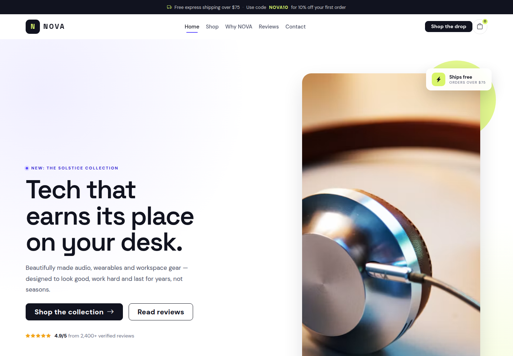
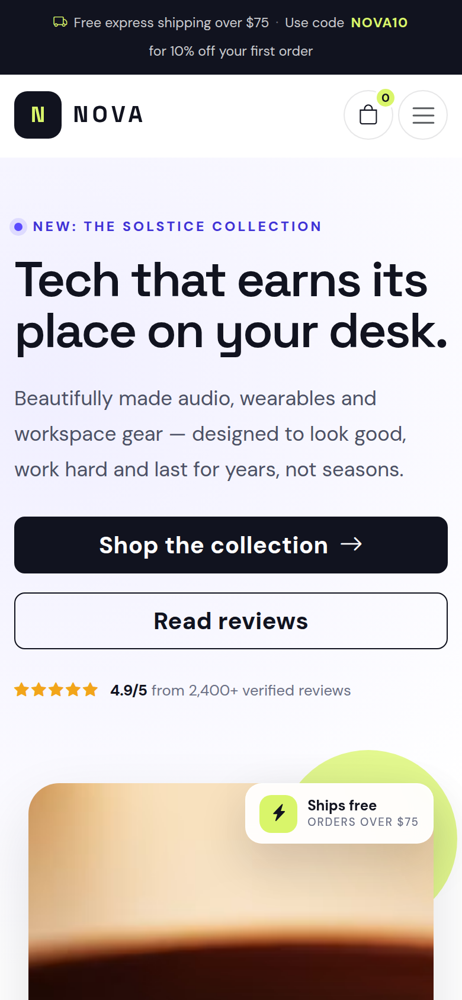

# NOVA — Responsive Store Landing Page

A responsive landing page for a fictional design-led tech store, built for the
**Responsive Web Design with CSS Libraries I (Bootstrap)** checkpoint.

The page combines **Bootstrap 5.3** (grid, navbar, cards, offcanvas cart, toasts)
with a custom stylesheet, so the layout stays responsive while the look stays
distinctly NOVA.

---

## Preview

**Desktop — 1440px** · [full-page screenshot](screenshots/desktop.png)



**Mobile — 390px (2×)** · [full-page screenshot](screenshots/mobile.png)



---

## Run it

No build step. Either:

```bash
# Option 1 — open the file directly
xdg-open store/index.html

# Option 2 — serve the repo locally (recommended)
python3 -m http.server 8000
# then visit http://localhost:8000/store/
```

The page uses CDN-hosted Bootstrap, Bootstrap Icons and Google Fonts, plus
Unsplash product photography, so an internet connection is needed for those
assets.

---

## Features

- **Header** — announcement bar, sticky navbar with section links, cart button
  with a live item badge, and a collapsible mobile menu.
- **Hero** — split layout with headline, calls to action, rating proof and
  floating product/shipping cards over the hero image.
- **Product section** — six product cards (`image`, `name`, description,
  rating, price, **Shop Now** button), with category filters for Audio,
  Wearables and Workspace.
- **Why NOVA** — image + benefit list + stats, with a floating "98%" card.
- **Reviews** — three customer testimonials with star ratings and initials
  avatars (no extra image requests).
- **Newsletter** — email field with inline validation and a confirmation toast.
- **Footer** — brand, shop/support/visit links, socials, payment badges and
  legal links.
- **Bootstrap components used** — responsive navbar/collapse, grid system,
  cards, buttons, offcanvas shopping bag, toasts, badges (custom), icons.

### Working interactions (vanilla JS, ~150 lines)

| Interaction | Behaviour |
| --- | --- |
| Category filters | Show only cards in the selected category, update `aria-pressed` |
| Shop Now | Adds the product to the cart, updates badge + subtotal, opens a toast |
| Cart drawer | Lists items, supports removing items, recalculates subtotal |
| Wishlist heart | Toggles saved state (visual demo) and confirms with a toast |
| Newsletter | Validates the email, shows an error state, confirms on success |
| Mobile menu | Closes automatically after tapping a link |
| Navbar | Gains a shadow/solid state once the page is scrolled |

---

## Design choices

**Palette.** Near-black ink `#11131f` for text and primary buttons keeps the
page calm and premium; electric violet `#5b4bff` marks brand moments, links and
badges; lime `#d9f56a` is reserved for energy — the announcement bar code, sale
badges, cart count and newsletter button. White and a soft grey (`#f5f6fa`)
alternate as section backgrounds so the page reads in clear bands.

**Typography.** Space Grotesk for headings gives a technical, contemporary
edge; DM Sans for body copy stays highly readable at small sizes. Headline
sizes use `clamp()` so they scale smoothly instead of jumping at breakpoints.

**Layout.** A standard 12-column Bootstrap grid does the heavy lifting:
a 6/6 hero, products at 3-up on desktop (`col-lg-4`), 2-up on tablets
(`col-sm-6`) and 1-up on phones. Cards use `h-100` plus `mt-auto` on the
price/button row so every card lines up regardless of description length.

**Product cards.** Image-first with a 1:1 crop, an overlaid status badge
(Bestseller / New / Save 20%) and a wishlist button. Hover lifts the card and
gently zooms the image — subtle, never distracting.

**Components from Bootstrap.** The navbar collapse, offcanvas cart and toast
system give the page real e-commerce behaviour without hand-rolling modals or
focus traps. Bootstrap Icons cover all iconography.

**Responsive strategy.** Breakpoints at 992px (nav collapse, stacked hero,
floating cards pulled inside the image), 768px (two-column trust strip,
wrapping newsletter field), 576px (tighter spacing, smaller floating cards) and
400px (full-width Shop Now buttons). All grids are fluid and images use
`aspect-ratio` + `object-fit`, so nothing overflows.

**Accessibility.** Skip link, `header`/`main`/`footer` landmarks, one `h1`,
meaningful `alt` text, `aria-label`/`aria-pressed`/`aria-live` on controls and
toasts, visible focus rings, and a `prefers-reduced-motion` block that disables
transitions. Text/background pairings were chosen for comfortable contrast.

**Performance.** One custom CSS file, a single vanilla script, Bootstrap/fonts
from CDN, and `loading="lazy"` + fixed `width`/`height` on product images to
avoid layout shift.

---

## Verified

- No horizontal overflow at **320, 375, 390, 768, 1024, 1440 and 1920px**.
- All 9 images load; no console errors or failed network requests.
- Cart (add, remove, subtotal, badge), filters, wishlist, offcanvas and
  newsletter validation tested in headless Chrome.
- Screenshots: desktop viewport **1440×1000**, mobile emulation **390×844 @2×**
  (full-page versions stitched from scrolling viewports).

---

## Files

```
store/
├── index.html          # Semantic markup + commented vanilla JS
├── css/
│   └── style.css       # Custom theme on top of Bootstrap 5.3
├── screenshots/
│   ├── desktop.png     # Full page, 1440px wide
│   ├── desktop-hero.png
│   ├── mobile.png      # Full page, 390px viewport @2×
│   └── mobile-hero.png
└── README.md
```
